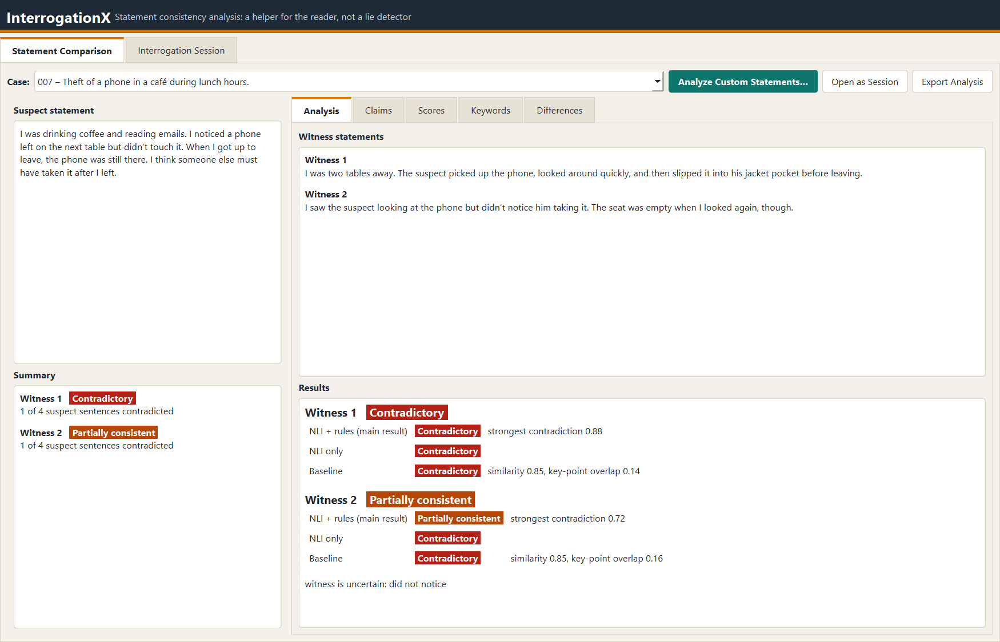
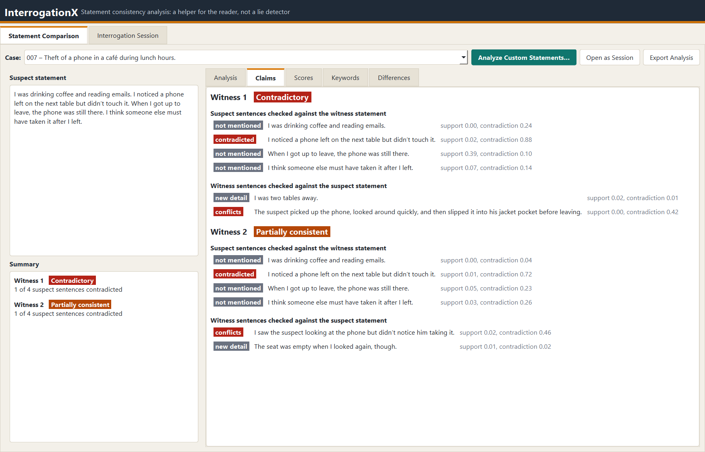
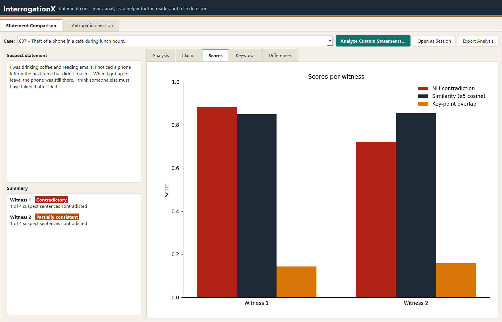
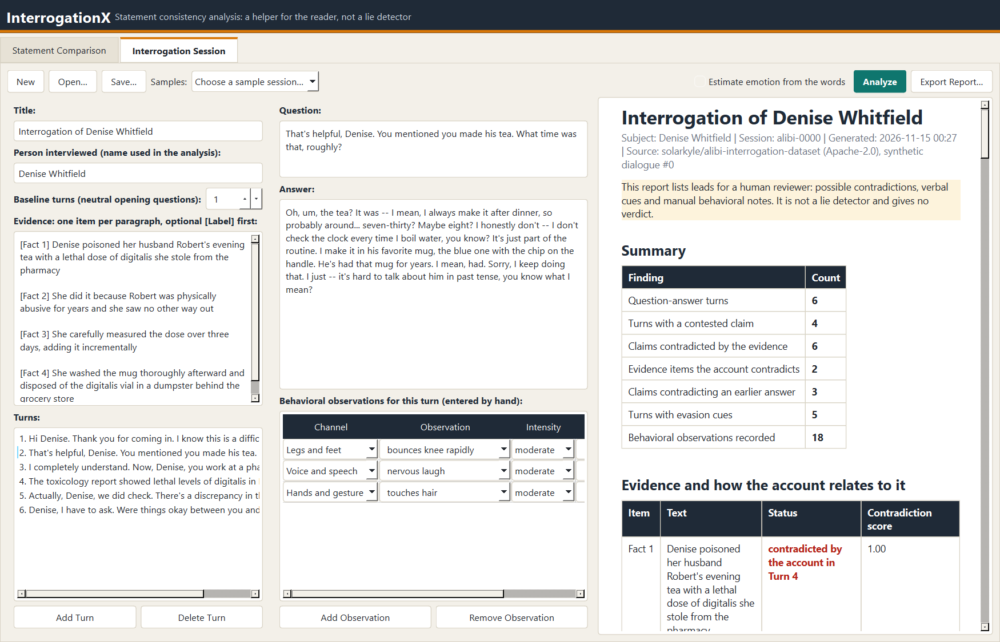
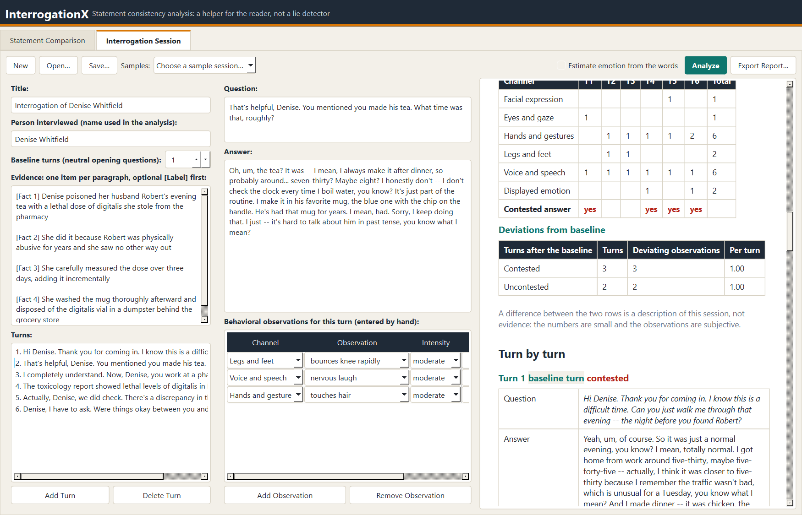

# InterrogationX

The idea is simple: when a suspect and a witness talk about
the same event, where do their stories agree and where do they clash?

The app reads the statements and marks the sentences that contradict each other. It also has a second screen
for a full interrogation (questions and answers), where I can type in notes about emotion and body language
and get everything in one report.

**Important:** this is not a lie detector. It only points to places a person should read again.



## What you can do with it

### 1. Compare a suspect statement with witness statements

Pick one of the 20 example cases (or paste your own text with *Analyze Custom Statements*). For every witness
the app gives one of three results:

- **Consistent**: nothing in the two stories clashes
- **Partially consistent**: small clash, or the witness is not sure ("I couldn't see")
- **Contradictory**: at least one clear clash

The *Claims* tab shows the result sentence by sentence, so you can see *why* it decided that:



The *Scores* tab shows the numbers behind it, and *Differences* lists the times, places and actions that
appear in only one of the two statements.



### 2. Analyze a full interrogation

The second screen is for a real question-answer session. On the left you write the evidence (witness
statements or known facts). In the middle you enter each question and answer. Under the answer there is a
table for **behavior notes**: face, eyes, hands, posture, legs, voice and emotion.



After pressing *Analyze* the report on the right shows:

- which answers clash with the evidence
- which answers clash with an earlier answer of the same person
- simple language cues: avoiding the question, "I don't remember", filler words, how many details were given
- the behavior notes, compared with how the person behaved in the first calm questions (the "baseline")



The report can be saved as an HTML file with *Export Report*.

## About the body language notes

The notes are typed in by hand. The app does **not** read faces from a camera, and it does **not** turn the
notes into a "lying score". I decided this for two reasons:

1. Research says body language is a weak sign of lying. Honest people are also nervous in an interrogation.
   (DePaulo et al. 2003, Bond & DePaulo 2006, Vrij et al. 2019)
2. I tested it. I found a dataset on Hugging Face with interrogation answers and body language notes, labeled
   "culprit" or "genuine". A very simple classifier gets **100%** from the body language words alone. It
   even gets 98% from the *question* text alone, which makes no sense for real data. So the dataset just
   repeats a stereotype (guilty people fidget), and a model trained on it would learn the stereotype.

What the app does instead: it shows where the notes are different from the person's own baseline, and whether
that happens on answers that also have a contradiction. It is a reminder to ask a follow-up question, nothing
more.

## How it works

1. **Split into sentences.** Both texts are cut into sentences with spaCy.
2. **Ask an NLI model.** NLI means "natural language inference": the model gets two texts and says if the
   second one follows from the first, contradicts it, or neither. I use `tasksource/deberta-base-long-nli`.
3. **Filter.** NLI models think both texts are about the same moment. So "he was drinking coffee" and "he
   picked up the phone" look like a contradiction to them. I only count a contradiction if the sentence shares
   an important word with the other statement, or if it is a denial like "I never left the house".
4. **Rules.** A few simple checks for things the model is bad at: different clock times (9 AM vs 3 PM),
   different numbers (two beers vs six beers), and "did" vs "did not" for the same verb.
5. **Decide.** Strong contradiction means *contradictory*. A weak one, or an unsure witness, means
   *partially consistent*. Otherwise *consistent*.

The first version of the project only compared the two texts with sentence embeddings (cosine similarity).
I kept it as the **baseline** to compare against.

## Data

| Data | From | What I use it for |
|---|---|---|
| 20 cases, 40 suspect-witness pairs | `forensic_statements_data_en.json` (fictional) | the examples in the app |
| Challenge set, 40 pairs | `labels/challenge_set.csv` | small test with known answers |
| Dialogue NLI | [pietrolesci/dialogue_nli](https://huggingface.co/datasets/pietrolesci/dialogue_nli) | choosing the NLI model |
| Alibi interrogations | [solarkyle/alibi-interrogation-dataset](https://huggingface.co/datasets/solarkyle/alibi-interrogation-dataset) (Apache-2.0) | sample sessions, session test |
| Interrogation cues | [darkknight25/Interrogation_Dataset_for_AI_Deception_Detection](https://huggingface.co/datasets/darkknight25/Interrogation_Dataset_for_AI_Deception_Detection) (MIT) | list of suggested cues, the stereotype test |

The Hugging Face data is downloaded when a script needs it. Only six short sample sessions and the list of
cue words are stored in this repository.

## Results

For every test I split the data in two halves. I choose models and thresholds on the first half ("dev") and
report the numbers of the second half ("test").

### Which NLI model? (Dialogue NLI, 300 test pairs, human-checked labels)

| Model | F1 for "contradiction" |
|---|---|
| e5 similarity only (the old idea) | not usable (AUC 0.43) |
| cross-encoder/nli-deberta-v3-base | 0.82 |
| MoritzLaurer/DeBERTa-v3-base-mnli-fever-anli | 0.88 |
| **tasksource/deberta-base-long-nli** | **0.97** |

The winner was trained on Dialogue NLI together with many other datasets, so this test is easier for it
than for the others. I still chose it, because it also behaved better on the interrogation sessions: the
first model gave almost every session a contradiction score of 1.0.

### Three-way result on the challenge set (40 pairs)

| System | Accuracy | Macro-F1 |
|---|---|---|
| Always "contradictory" | 0.53 | 0.23 |
| Baseline (similarity + key points) | 0.28 | 0.20 |
| NLI without the filter | 0.85 | 0.77 |
| NLI | 0.85 | 0.73 |
| **NLI + rules (the one the app uses)** | **0.95** | **0.94** |
| Logistic regression on all scores (5-fold CV) | 0.85 | 0.82 |

The baseline is worse than always saying "contradictory". That was the main problem of my first version:
similar words do not mean the stories agree. "I took it" and "I didn't take it" are almost the same sentence.

### Can it tell a false alibi from a true one? (alibi sessions, 40 dev + 40 test)

Here every session has a list of true facts, and I know if the suspect's alibi is a lie.

| Session score | Dev AUC | Test AUC |
|---|---|---|
| e5 similarity | 0.53 | 0.48 |
| Strongest single contradiction | 0.56 | 0.64 |
| **Evidence conflict index** | **0.77** | **0.72** |

My first try (take the strongest contradiction in the session) did not work: almost every long conversation
has one sentence that looks contradictory. The *evidence conflict index* works better. For each fact it takes
"how much the answers contradict it" minus "how much they confirm it", and averages over the facts.

An AUC of about 0.72 is a useful hint but far from reliable, and these dialogues were written by a language
model, not by real people. This is one more reason the app never says "this person is lying".

### What I am careful about

- The challenge set was written for this project together with the rules. Some of its pairs use the same
  kind of words the rules look for, so it is not an independent test.
- The 40 pairs of the main dataset have no human labels yet. `labels/GUIDELINES.md` explains how two people
  should label them. After that `python evaluate.py systems labels/gold.csv` gives the real numbers.
- All data is fictional or synthetic. Nothing here was tested on real statements.

## Web version (Flask)

The folder `web/` has an earlier version of the project as a web app. It is a Flask server with a small REST
API and a browser page. It does not use the NLI model. Instead it compares the statements sentence by
sentence with eight rule-based checks (negation, antonyms, verb conflicts, numbers, times, entities,
quantifiers, properties) and saves every analysis in a SQLite database.

```bash
cd web
pip install -r requirements.txt
python app.py
```

Then open http://localhost:5000. There is also a Dockerfile: `docker compose up --build` inside `web/`.
More details are in [web/README.md](web/README.md).

## How to run it

Tested with Python 3.10 on Windows.

**Easy way:** double-click `run_analyzer.bat`. The first start creates a virtual environment and installs
everything (this takes a while because of PyTorch). After that it opens the app directly.

**By hand:**

```bash
python -m venv .venv
.venv\Scripts\activate
pip install -r requirements.txt
python interrogation_analyzer_gui.py
```

The models (about 1.7 GB) are downloaded from Hugging Face on the first analysis.

Other commands:

| Command | What it does |
|---|---|
| `python -m pytest` | runs the tests |
| `python evaluate.py systems labels/challenge_set.csv` | compares the systems on a labeled file |
| `python evaluate.py agreement labels/annotator_A.csv labels/annotator_B.csv` | agreement between two annotators (Cohen's kappa) |
| `python benchmarks.py dnli` | NLI model test on Dialogue NLI |
| `python benchmarks.py alibi` | false/true alibi test on the sessions |
| `python benchmarks.py cues` | the body language stereotype test |
| `python external_datasets.py samples` | rebuilds the sample sessions from the alibi dataset |

## Files

| File | What is inside |
|---|---|
| `interrogation_analyzer_gui.py` | main window and the comparison screen |
| `session_view.py` | interrogation session screen |
| `theme.py` | colors of the app |
| `nli_consistency.py` | sentence-by-sentence check with the NLI model |
| `rule_checks.py` | rules for times, numbers, negation and unsure witnesses |
| `interrogation_analysis.py` | analysis of a whole session |
| `observations.py` | behavior notes and the baseline comparison |
| `sessions.py` | saving and loading sessions |
| `report.py` | the HTML report |
| `statement_similarity_analysis.py` | the first version (baseline) and the key-point extraction |
| `evaluate.py`, `benchmarks.py` | the tests behind the tables above |
| `external_datasets.py` | downloading and converting the Hugging Face data |
| `config.py`, `models.py`, `data.py` | settings, model loading, reading the dataset |
| `tests/` | unit tests |
| `web/` | the Flask web version (separate, see above) |

## References

- DePaulo, B. M. et al. (2003). Cues to deception. *Psychological Bulletin*, 129(1).
- Bond, C. F. & DePaulo, B. M. (2006). Accuracy of deception judgments. *Personality and Social Psychology
  Review*, 10(3).
- Vrij, A., Hartwig, M. & Granhag, P. A. (2019). Reading lies: nonverbal communication and deception. *Annual
  Review of Psychology*, 70.
- Welleck, S. et al. (2019). Dialogue Natural Language Inference. *ACL 2019*.
